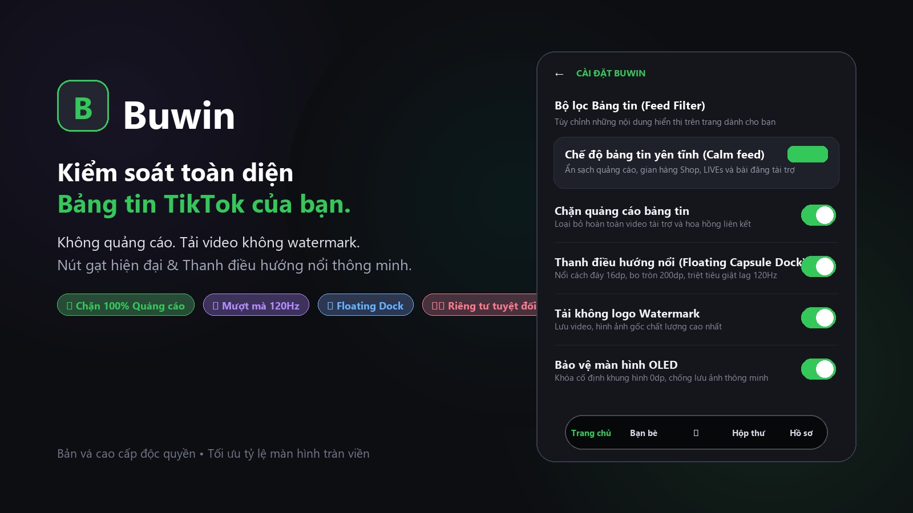
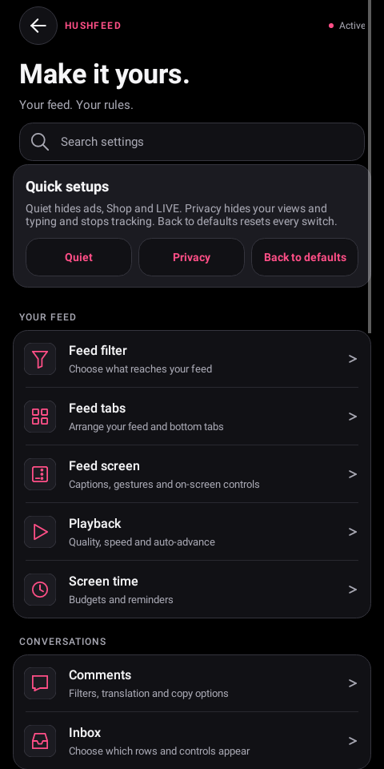
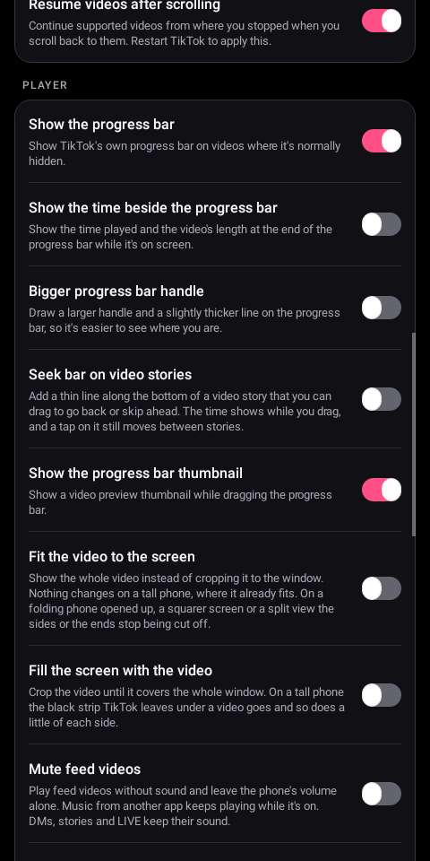
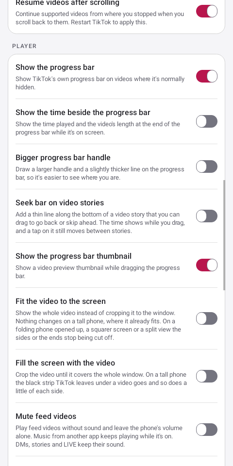

<p align="center">
  <a href="CHANGELOG.md"></a>
  <a href="LICENSE"></a>
  <a href="https://www.android.com/"></a>
  <a href="https://github.com/MorpheApp/morphe-manager"></a>
  <a href="https://github.com/minh-quann/buwin-tiktok-patches/issues"></a>
  <a href="https://www.apkmirror.com/apk/tiktok-pte-ltd/tik-tok-including-musical-ly/"></a>
</p>

# Buwin TikTok Patches

**Buwin** là bộ bản vá mã nguồn mở cao cấp dành cho ứng dụng TikTok, hoạt động trên nền tảng trình quản lý [Morphe](https://github.com/MorpheApp/morphe-manager). Bạn chỉ cần chuẩn bị tệp APK TikTok gốc, Morphe Manager sẽ tự động áp dụng các bản vá trực tiếp trên điện thoại của bạn. Ứng dụng sau khi vá sẽ có riêng một trang quản trị **Cài đặt Buwin** ngay đầu menu cài đặt, cho phép bật hoặc tắt từng tính năng tùy ý.

Loại bỏ sạch sẽ quảng cáo và các thành phần giao diện gây rối mắt trên video. Yêu cầu chạm xác nhận lần hai trước khi bấm Theo dõi hoặc Thích để chống chạm nhầm. Tải video và hình ảnh chất lượng gốc không có logo hình mờ (Watermark), ngăn chặn toàn diện các tiến trình theo dõi thói quen người dùng và báo cáo sự cố gửi về máy chủ.

Hầu hết các công tắc mặc định đều ở trạng thái tắt, giúp ứng dụng sau khi vá giữ nguyên giao diện gốc ban đầu cho đến khi bạn chủ động bật tính năng mong muốn.

**[Thêm Buwin vào Morphe](https://morphe.software/add-source?github=minh-quann%2Fbuwin-tiktok-patches)** | [Tải gói bản vá mới nhất (.mpp)](https://github.com/minh-quann/buwin-tiktok-patches/releases/latest) | [Xem danh mục 135 bản vá](#danh-mục-135-bản-vá-chi-tiết)

---

## 💎 Những cải tiến kỹ thuật & Giao diện độc quyền của Buwin

Phiên bản này được tích hợp các giải pháp tùy biến sâu về giao diện và tối ưu hóa phần cứng, đặc biệt tinh chỉnh cho các dòng điện thoại màn hình dài cao cấp (tỷ lệ $19.55:9$, độ phân giải $1320 \times 2868$, `sw = 400dp` và tần số quét cao $120\text{Hz}$):

### 1. 💊 Thanh điều hướng nổi dạng viên thuốc (Floating Capsule Dock)
- **Tỷ lệ công thái học thoáng đãng:** Chiều cao thanh được mở rộng lên **$64\text{dp}$**, kết hợp khoảng đệm (padding) trên/dưới **$16\text{dp}$** và lề hai bên **$16\text{dp}$**. Các biểu tượng điều hướng (*Trang chủ, Bạn bè, +, Hộp thư, Hồ sơ*) nằm ngay ngắn ở trung tâm, không bị dính sát mép viền hay gò bó.
- **Độ cao nổi phía trên vạch cử chỉ:** Nâng cao cách đáy màn hình **$16\text{dp}$**, nằm tách biệt lơ lửng phía trên thanh điều hướng cử chỉ hệ thống, không gây chạm nhầm khi vuốt về màn hình chính.
- **Bo cong hình viên thuốc hoàn hảo:** Bán kính góc bo tối đa **$200\text{dp}$**, tạo nên đường cong mềm mại và liền mạch ở hai đầu mút.
- **Chất liệu kính tối bán trong suốt (Dark Frosted Glass):** Nền đen tro mờ ảo sang trọng (`#50000000`, độ đục 31%) đi kèm đường viền phản quang siêu mảnh (`#26FFFFFF`, độ đục 15%), giúp thanh nổi luôn rõ nét và thẩm mỹ trên mọi nền video sáng tối.
- **Triệt tiêu hoàn toàn giật lag cuộn (Khử Layout Thrashing 120Hz):** Khóa cố định chiều cao bottom spacer và cho phép `collapseAllowed()` luôn hợp lệ. Cơ chế này loại bỏ triệt để vòng lặp tính toán lại layout liên tục giữa thanh nổi và video, giúp thao tác vuốt cuộn bảng tin đạt độ mượt mà tuyệt đối ở tần số quét $120\text{Hz}$.

### 2. 🔘 Nút gạt chuyển đổi hiện đại (Modern Fluid Switch Toggles)
- **Tỷ lệ rãnh chuyển đổi:** Thiết kế lại toàn bộ nút gạt trong trang cài đặt với kích thước rãnh chuẩn $51 \times 31\text{dp}$, bo tròn góc $16\text{dp}$.
- **Phối màu trực quan:** Màu kích hoạt xanh ngọc lục bảo (`#34C759`) nổi bật; nền tắt xám tối thanh lịch (`#39393D` ở Chế độ tối) và xám nhạt (`#E9E9EA` ở Chế độ sáng).
- **Cần trượt tròn nổi khối:** Cần gạt hình tròn màu trắng tinh khôi (`#FFFFFF`, đường kính $27\text{dp}$, bán kính $14\text{dp}$) tích hợp viền bóng đổ ambient mờ nhẹ $1\text{dp}$ (`#1A000000`), mang lại phản hồi xúc giác thị giác mượt mà và chính xác.

### 3. 📱 Hiển thị tràn viền & Phủ kín thanh trạng thái (See-Through Status Bar)
- **Mở rộng tỷ lệ scale viền trên:** Tăng `MAX_FILL_SCALE` từ $1.2\times$ lên **$1.45\times$**, giúp khung hình video phủ kín toàn bộ khu vực thanh trạng thái và cụm camera nốt ruồi mà không bao giờ xuất hiện khoảng hở hoặc vệt đen viền trên màn hình dài.
- **Hỗ trợ Cutout hiển thị:** Áp dụng cờ `LAYOUT_IN_DISPLAY_CUTOUT_MODE_SHORT_EDGES` trên Android 9 trở lên để đảm bảo hình ảnh hiển thị không viền toàn diện.
- **Khử mép răng cưa Sub-pixel:** Tích hợp tỷ lệ bù mép sub-pixel (`1.008f`) nhằm triệt tiêu hoàn toàn các đường viền đen siêu mảnh $1\text{px} - 4\text{px}$ trên các màn hình mật độ điểm ảnh cao.

### 4. 🛡️ Bảo vệ màn hình OLED thông minh (Intelligent OLED Burn-In Guard)
- **Triệt tiêu viền đen dịch chuyển 7px:** Đặt bước dịch chuyển `STEP_DP = 0.0f`, cố định tâm hiển thị video, chấm dứt hoàn toàn hiện tượng lệch khung hình gây viền đen $7\text{px}$ khó chịu.
- **Duy trì cơ chế làm mờ bảo vệ điểm ảnh:** Vẫn giữ nguyên 100% tính năng tự động làm mờ nhẹ 25% sau 5 giây không có tương tác cảm ứng, bảo vệ tấm nền OLED cao cấp chống hiện tượng lưu ảnh (burn-in) do các icon tĩnh.

### 5. 🏷️ Nhận diện thương hiệu Buwin đồng bộ 100%
- Toàn bộ bytecode Smali, giao diện menu, trang thông tin Giới thiệu, bảng điều khiển chẩn đoán và thông báo hệ thống đều mang tên **Buwin**.
- Mọi liên kết mã nguồn và báo lỗi trỏ thẳng về repository chính thức: [minh-quann/buwin-tiktok-patches](https://github.com/minh-quann/buwin-tiktok-patches).

---

## Những thay đổi mà Buwin mang lại

- **Bảng tin (Feed):** Kích hoạt nhanh chế độ Yên tĩnh (Calm feed) hoặc chủ động ẩn quảng cáo, gian hàng TikTok Shop, phòng LIVE, tin 24h (Stories), bài đăng ảnh và bất kỳ nhà sáng tạo hoặc video nào theo từ khóa bộ lọc cá nhân. Video do chính bạn đăng sẽ không bao giờ bị ẩn. Cho phép cài đặt TikTok tự động mở vào tab Đang theo dõi, Bạn bè, Hộp thư hoặc Hồ sơ thay vì trang Dành cho bạn.
- **Điều khiển cảm ứng & Cử chỉ:** Yêu cầu xác nhận chạm lần hai trước khi Theo dõi, Thích hoặc Đăng lại nhanh để tránh chạm nhầm khi lướt. Tùy biến hoặc tắt tính năng nhấn giữ và chạm hai lần (Double tap). Giữ nguyên vị trí video hiện tại trên Bảng tin khi bấm vào biểu tượng Trang chủ.
- **Phát lại video (Playback):** Tự do lựa chọn tốc độ và chất lượng video mong muốn, tắt tính năng lặp lại video vô tận, tự động phát tiếp video kế tiếp khi xem xong hoặc ghi nhớ mốc thời gian xem dở dang. Cho phép video tiếp tục phát âm thanh trong nền khi bạn rời khỏi ứng dụng hoặc tắt màn hình.
- **Tải xuống đa phương tiện (Downloads):** Lưu video không logo hình mờ, tải ảnh kích thước đầy đủ, trích xuất nhạc nền riêng biệt và tải tệp phụ đề SRT rời vào các thư mục và định dạng tên tệp do bạn tùy chọn. Tính năng tải xuống hoạt động hiệu quả ngay cả trên các video bị chủ sở hữu khóa nút lưu.
- **Bình luận & Hộp thư đến:** Lọc bình luận theo từ khóa hoặc tài khoản chỉ định và tự động dịch bình luận sang ngôn ngữ của bạn. Tùy chọn ẩn các hàng mục không cần thiết trong Hộp thư đến.
- **Bảo mật & Quyền riêng tư:** Tắt toàn bộ các dịch vụ gửi dữ liệu phân tích và báo cáo lỗi về máy chủ, kích hoạt chế độ ẩn danh (Ghost mode - xem story không để lại vết xem, ẩn trạng thái đang nhập tin nhắn), không lưu video đã xem vào Lịch sử xem và khóa ứng dụng bằng vân tay, nhận diện khuôn mặt hoặc mã PIN.
- **Quản lý thời gian sử dụng:** Thiết lập hạn mức xem video mỗi ngày theo số lượng video hoặc số phút, kèm tính năng khóa bảng tin khi hết thời gian để bạn chỉ dùng TikTok cho mục đích nhắn tin.

Giao diện cài đặt Buwin hỗ trợ đa ngôn ngữ đầy đủ và tự động thay đổi theo ngôn ngữ hiển thị của ứng dụng TikTok.

Các phím tắt Chặn, Ẩn, Chặn âm thanh và Không quan tâm mà Buwin có thể gắn trực tiếp lên video:


---

## Hướng dẫn cài đặt từng bước

1. **Chuẩn bị tệp APK TikTok gốc:** Tải tệp TikTok phiên bản **47.1.4** hoặc **47.4.3** từ APKMirror: [TikTok 47.1.4 Release APK](https://www.apkmirror.com/apk/tiktok-pte-ltd/tik-tok-including-musical-ly/tiktok-47-1-4-release/) hoặc [TikTok 47.4.3 Release APK](https://www.apkmirror.com/apk/tiktok-pte-ltd/tik-tok-including-musical-ly/tiktok-47-4-3-release/). Trên Android 11 trở lên, Morphe Manager sẽ tự động kiểm tra chữ ký gốc của TikTok để đảm bảo tệp nguyên bản chưa bị chỉnh sửa.
2. **Cài đặt Morphe Manager:** Sử dụng Morphe Manager phiên bản **1.34.0** trở lên. Trước khi vá, hãy vào **Cài đặt trong Morphe Manager > Tiến trình thực thi (Process runtime)** và tăng dung lượng bộ nhớ lên ít nhất **1,024 MB** để quá trình biên dịch không bị nghẽn RAM.
3. **Thêm nguồn Buwin vào Morphe:**
   - Trên điện thoại, bạn có thể nhấn vào liên kết: [Thêm Buwin vào Morphe](https://morphe.software/add-source?github=minh-quann%2Fbuwin-tiktok-patches).
   - Hoặc mở Morphe Manager $\to$ chọn tab **Nguồn (Sources)** $\to$ nhấn dấu **+** $\to$ dán đường dẫn: `https://github.com/minh-quann/buwin-tiktok-patches`.
   - Bạn cũng có thể tải trực tiếp tệp gói `.mpp` từ trang [Releases mới nhất](https://github.com/minh-quann/buwin-tiktok-patches/releases/latest) và nạp vào dưới dạng tệp cục bộ.
4. **Chọn các bản vá:** Ở chế độ Đơn giản (Simple mode), Morphe Manager sẽ tự động chọn sẵn 117 bản vá tối ưu. 18 bản vá chuyên sâu còn lại có thể bật qua chế độ Chuyên gia (Expert mode).
5. **Tiến hành vá APK:** Chọn tệp APK TikTok gốc đã tải ở Bước 1 và bấm Patch. Luôn giữ nguyên khóa ký (Keystore) mặc định của trình quản lý để các bản cập nhật sau này có thể cài đè mà không làm mất dữ liệu đăng nhập.
6. **Cài đặt và sử dụng:** Cài đặt ứng dụng đã vá, mở TikTok $\to$ vào **Cài đặt và quyền riêng tư (Settings and privacy)**. Mục **Buwin** sẽ nằm ngay vị trí đầu tiên.

> [!NOTE]
> Các bản vá loại bỏ tệp tài nguyên thừa (như ngôn ngữ, công cụ quay video) sẽ xóa trực tiếp trong lúc đóng gói APK. Vì vậy tính năng Tạm dừng hay Khôi phục cài đặt không thể lấy lại các tệp này nếu bạn đã chọn xóa chúng lúc vá.

---

## Quản trị cài đặt Buwin

Ngoài mục xuất hiện ở đầu trang **Cài đặt và quyền riêng tư** của TikTok, bạn có thể truy cập nhanh vào cài đặt Buwin bằng hai phím tắt tiện lợi mà không cần mở trang Hồ sơ cá nhân:
- **Nhấn và giữ chữ "Dành cho bạn"** ở đầu bảng tin video.
- **Nhấn và giữ biểu tượng "Trang chủ"** ở thanh điều hướng nổi phía dưới cùng (yêu cầu bật bản vá *Feed tab navigation*).

Trang chủ cài đặt Buwin tích hợp thanh tìm kiếm thông minh giúp bạn tìm nhanh bất kỳ cài đặt nào theo tên hoặc mô tả và bật/tắt công tắc trực tiếp ngay trong kết quả tìm kiếm. Ngay bên dưới là nút Cài đặt nhanh (Quick setups) để bật chế độ Yên tĩnh, Riêng tư hoặc đưa mọi cài đặt về mặc định chỉ với một chạm.

Các trang cài đặt được phân nhóm khoa học theo từng danh mục:

| Nhóm danh mục | Các trang cài đặt chi tiết |
| --- | --- |
| **Bảng tin của bạn** | Bộ lọc bảng tin, Điều hướng tab, Giao diện bảng tin, Phát lại và Thời gian sử dụng |
| **Trò chuyện** | Bình luận và Hộp thư đến |
| **Lưu & Chia sẻ** | Tải xuống và Bảng chia sẻ (Share sheet) |
| **Quyền riêng tư & Ứng dụng** | Quyền riêng tư, Ứng dụng, Khu vực, Sao lưu & Khôi phục, và Feature Gate Lab |
| **Buwin** | Trạng thái, Tạm dừng Buwin, Chẩn đoán, Giới thiệu Buwin, Báo lỗi và Hỗ trợ dự án |

### Một số trang cài đặt quan trọng bạn nên biết:
- **Tạm dừng Buwin (Pause Buwin):** Cho phép tạm ngưng toàn bộ các tính năng can thiệp thời gian chạy kể từ lần mở ứng dụng tiếp theo nhưng vẫn lưu giữ nguyên vẹn mọi cấu hình bạn đã chọn.
- **Sao lưu và khôi phục (Backup and restore):** Xuất toàn bộ cấu hình cài đặt và các quy tắc Feature Gate Lab ra tệp JSON an toàn. Bạn có thể khôi phục lại bất kỳ lúc nào trên máy mới.
- **Nhập lịch sử đã xem (Import watch history):** Nằm trong mục *Bộ lọc bảng tin > Video đã xem*. Tính năng này đọc tệp JSON xuất ra từ [dữ liệu TikTok của bạn](https://support.tiktok.com/vi/account-and-privacy/personalized-ads-and-data/requesting-your-data), giúp bộ lọc nhận diện chính xác toàn bộ danh sách video bạn đã xem trước đó để không hiển thị lại.
- **Công cụ chẩn đoán (Diagnostics):** Xuất báo cáo kỹ thuật khi gặp sự cố. Mục **Trạng thái Hook (Hook status)** sẽ kiểm tra chi tiết xem các điểm can thiệp smali có gắn thành công vào phiên bản TikTok của bạn hay không.
- **Phòng thí nghiệm cờ tính năng (Feature Gate Lab):** Cho phép thay đổi các giá trị cờ thử nghiệm nội bộ của TikTok với các mẫu thiết lập sẵn an toàn và tính năng hoàn tác một chạm.

Giao diện cài đặt Buwin sử dụng hệ thống thẻ bo góc đồng bộ, phông chữ tinh tế và các nút gạt chuyển đổi hiện đại trên cả Chế độ tối và Chế độ sáng.

  

---

## Danh mục 135 bản vá chi tiết

Bảng tra cứu toàn bộ 135 bản vá mã nguồn của Buwin, bao gồm mô tả chức năng, trạng thái kích hoạt mặc định và vị trí menu trong ứng dụng:

| Tên bản vá (Morphe Patch) | Mô tả tính năng chi tiết |
|---|---|
| `Accent color` | Thay đổi màu đỏ chủ đạo của các nút bấm chính và văn bản sang màu xanh dương, xanh lá, tím, cam, mòng két, mã màu tự chọn, hoặc lấy theo màu hình nền hệ thống (từ Android 12 trở lên). Áp dụng trực tiếp lúc vá APK. |
| `Advanced downloads` | Bổ sung nhiều chế độ lưu cao cấp: chọn độ phân giải video, tải ảnh gốc độ nét cao, tách riêng âm thanh nền, gộp bài đăng ảnh thành video MP4, nhấn giữ ảnh đại diện hoặc story để tải về, tải video hàng loạt từ trang cá nhân. Mặc định tắt. Bật trong Cài đặt Buwin > Tải xuống. |
| `Allow Duet and Stitch` | Hiển thị nút Duet và Stitch trên cả những video mà tác giả đã tắt tính năng này. Mặc định tắt. Bật trong Cài đặt Buwin > Bảng chia sẻ. |
| `Allow screenshots and Circle to Search` | Cho phép chụp ảnh màn hình, quay video màn hình và sử dụng tính năng Khoanh tròn để tìm kiếm (Circle to Search) trên những màn hình bị TikTok khóa đen. Mặc định tắt. Bật trong Cài đặt Buwin > Ứng dụng, sau đó khởi động lại app. |
| `Always show publish date` | Hiển thị ngày và giờ đăng video chi tiết ngay cạnh tên tác giả. Bật sẵn mặc định. Tùy chỉnh trong Cài đặt Buwin > Giao diện bảng tin. |
| `Always upload in HD` | Luôn tải video lên với chất lượng độ phân giải cao nhất (HD) mà không cần bật thủ công mỗi lần đăng bài. Mặc định tắt. Bật trong Cài đặt Buwin > Ứng dụng. |
| `AMOLED dark theme` | Chuyển toàn bộ nền xám của giao diện Chế độ tối sang màu đen tuyền ($#000000$), giúp tiết kiệm pin tối đa cho màn hình OLED. Áp dụng lúc vá APK. |
| `App lock` | Khóa ứng dụng bằng vân tay, khuôn mặt hoặc mã PIN mỗi khi mở TikTok hoặc khi quay lại sau một khoảng thời gian nhất định. Mặc định tắt. Bật trong Cài đặt Buwin > Quyền riêng tư. |
| `Automatic video advance` | Tự động chuyển sang video tiếp theo khi video hiện tại kết thúc mà không cần vuốt tay. Mặc định tắt. Bật trong Cài đặt Buwin > Phát lại. |
| `Block author button` | Gắn thêm nút thao tác nhanh trên video để chặn tác giả, ẩn tác giả trên máy hoặc chặn âm thanh chỉ với một chạm. Mặc định tắt. Bật trong Cài đặt Buwin > Giao diện bảng tin. |
| `Block contact list access` | Trả về danh bạ trống khi TikTok yêu cầu quyền đọc danh bạ điện thoại, bảo vệ sự riêng tư của bạn bè và người thân. Mặc định tắt. Bật trong Cài đặt Buwin > Quyền riêng tư. |
| `Block installed app scanning` | Trả về danh sách ứng dụng trống khi TikTok quét danh mục ứng dụng đã cài trên máy bạn. Mặc định tắt. Bật trong Cài đặt Buwin > Quyền riêng tư. |
| `Block P2P video relay` | Loại bỏ các tệp tin TikTok dùng để biến điện thoại của bạn thành trạm phát lại video cho người khác qua mạng P2P, giúp giảm kích thước APK khoảng 3.5 MB và tiết kiệm băng thông mạng. Áp dụng lúc vá APK. |
| `Block popups` | Chặn các cửa sổ bật lên phiền toái như gợi ý kết bạn, khuyến mãi hoặc lời mời tham gia sự kiện. Mặc định tắt. Bật trong Cài đặt Buwin > Giao diện bảng tin. |
| `Block suggested video notifications` | Chặn các thông báo "Video bạn có thể thích" phiền toái. Thông báo tin nhắn, bình luận và bài đăng từ người theo dõi vẫn nhận bình thường. Bật sẵn mặc định. |
| `Camera and microphone indicator` | Hiển thị dấu chấm cảnh báo nhỏ ở góc màn hình khi TikTok đang truy cập máy ảnh hoặc micrô. Mặc định tắt. Bật trong Cài đặt Buwin > Quyền riêng tư. |
| `Change app name` | Đổi tên hiển thị của ứng dụng ngoài màn hình chính theo ý bạn để dễ phân biệt với bản TikTok thông thường. Áp dụng lúc vá APK. |
| `Comment publish diagnostics` | Ghi lại nhật ký chẩn đoán khi gửi bình luận thất bại, giúp xác định nguyên nhân bình luận bị ẩn không lý do. Hoạt động tự động sau khi vá. |
| `Comment send fix` | Khắc phục triệt để lỗi TikTok tự động hủy bình luận mà không hiển thị thông báo lỗi. Hoạt động tự động sau khi vá. |
| `Comment sort controls` | Luôn hiển thị đầy đủ menu sắp xếp bình luận (Bình luận hàng đầu, Mới nhất, Bình luận có ảnh/video và Bình luận của tác giả). Mặc định tắt. Bật trong Cài đặt Buwin > Bình luận. |
| `Comment tools` | Ẩn bình luận chứa từ khóa hoặc từ tài khoản bạn chỉ định, thêm thanh tìm kiếm trong bình luận và cho phép bấm vào liên kết trong bình luận. Mặc định tắt. Bật trong Cài đặt Buwin > Bình luận. |
| `Confirm feed interactions` | Yêu cầu chạm xác nhận lần hai trước khi Theo dõi, bấm Thích hoặc Đăng lại nhanh để tránh chạm nhầm khi lướt video. Mặc định tắt. Bật trong Cài đặt Buwin > Giao diện bảng tin. |
| `Copy bio and IDs` | Cho phép nhấn giữ tiểu sử để sao chép, và thêm nút sao chép ID người dùng, ID video trong bảng chia sẻ. Bật sẵn mặc định. |
| `Copy comments without username` | Khi sao chép bình luận, chỉ sao chép nội dung chữ thuần túy mà không bị dính kèm tên người dùng phía trước. Bật sẵn mặc định. |
| `Custom launcher icon` | Tùy biến biểu tượng ứng dụng ngoài màn hình chính thành biểu tượng theo chủ đề màu hệ thống (Android 13+), biểu tượng đơn sắc hoặc hình tùy chọn. Áp dụng lúc vá APK. |
| `Custom offline videos limit` | Tùy chỉnh giới hạn số lượng video TikTok cho phép tải về xem ngoại tuyến (từ 1 đến 10,000 video) và lưu giữ không giới hạn thời gian. Mặc định tắt. Bật trong Cài đặt Buwin > Tải xuống. |
| `Device privacy guard` | Ngăn chặn TikTok đọc dữ liệu trong khay nhớ tạm (Clipboard), ẩn mã quảng cáo (GAID), ẩn kết nối VPN và trạng thái Root. Mặc định tắt. Bật trong Cài đặt Buwin > Quyền riêng tư. |
| `Diagnostic tools` | Cung cấp hệ thống ghi nhật ký và xuất báo cáo chẩn đoán chi tiết khi gặp lỗi. Mặc định tắt. Bật trong Cài đặt Buwin > Chẩn đoán. |
| `Disable login requirement` | Gỡ bỏ hoàn toàn yêu cầu bắt buộc phải đăng nhập tài khoản mới được tiếp tục lướt video. Hoạt động tự động sau khi vá. |
| `Disable screen capture detection` | Ngăn chặn TikTok phát hiện hành động chụp ảnh màn hình hoặc quay video màn hình của bạn. Hoạt động tự động sau khi vá. |
| `Disable telemetry` | Vô hiệu hóa toàn bộ tiến trình gửi dữ liệu phân tích sử dụng và nhật ký sự cố về máy chủ TikTok và các bên thứ ba. Mặc định tắt. Bật trong Cài đặt Buwin > Quyền riêng tư. |
| `Disable the long press quick share` | Vô hiệu hóa menu chia sẻ nhanh khi nhấn giữ nút Chia sẻ, tránh gửi nhầm video cho người khác. Mặc định tắt. Bật trong Cài đặt Buwin > Giao diện bảng tin. |
| `Disable the long press repost` | Vô hiệu hóa tính năng đăng lại nhanh khi nhấn giữ nút Thích. Mặc định tắt. Bật trong Cài đặt Buwin > Giao diện bảng tin. |
| `Double-tap controls` | Tùy biến hành động khi chạm hai lần vào màn hình: không làm gì cả, mở bình luận, sao chép liên kết, lưu âm thanh, tua nhanh hoặc hẹn giờ ngủ thay vì tự động thả tim. Mặc định tắt. Tùy chỉnh trong Cài đặt Buwin > Giao diện bảng tin. |
| `Downloads` | Tải video và hình ảnh chất lượng cao không có logo mờ của TikTok, hỗ trợ tải cả khi chủ kênh khóa nút tải, tự do chọn thư mục lưu và cấu trúc đặt tên file. Bật sẵn mặc định. |
| `Drop the animated image cache` | Tối ưu hóa bộ nhớ RAM bằng cách giải mã nhãn dán động và ảnh GIF theo từng khung hình phát thay vì tải trước hàng loạt. Mặc định tắt. Bật trong Cài đặt Buwin > Ứng dụng. |
| `Enable voice comments` | Kích hoạt tính năng bình luận bằng giọng nói cho các tài khoản chưa được TikTok mở tính năng này. Mặc định tắt. Bật trong Cài đặt Buwin > Bình luận. |
| `Expand activity list` | Luôn mở rộng danh sách Hoạt động và Người theo dõi mới trong Hộp thư đến mà không cần bấm "Xem tất cả". Mặc định tắt. Bật trong Cài đặt Buwin > Hộp thư đến. |
| `Feature Gate Lab` | Trang thí nghiệm nâng cao cho phép can thiệp và kích hoạt các tính năng ẩn thử nghiệm của TikTok. Mặc định tắt. Bật trong Cài đặt Buwin > Chẩn đoán. |
| `Feature Gate Recorder` | Ghi lại các cờ thử nghiệm mà TikTok truy xuất trong quá trình bạn sử dụng ứng dụng để phục vụ nghiên cứu. Mặc định tắt. Bật trong Cài đặt Buwin > Chẩn đoán. |
| `Feed filter` | Lọc sạch quảng cáo trên bảng tin, cho phép ẩn thêm phòng LIVE, bài viết TikTok Shop, video gắn nhãn AI hoặc lọc video theo từ khóa, tài khoản chỉ định. Chặn quảng cáo được bật sẵn. |
| `Feed tab navigation` | Tùy chỉnh ẩn/hiện các tab trên đầu feed và thanh điều hướng bên dưới, đổi tên tab, chọn tab mặc định khi mở app và chống tải lại video khi chạm nút Trang chủ. Quản lý trong Cài đặt Buwin > Điều hướng tab. |
| `Feed text sizes` | Cho phép tăng hoặc giảm kích thước phông chữ của phần mô tả video, tên tác giả và ngày đăng để dễ đọc hơn. Mặc định tắt. Bật trong Cài đặt Buwin > Giao diện bảng tin. |
| `Fit the video to the screen` | Hiển thị trọn vẹn toàn bộ khung hình video mà không bị cắt xén hai bên mép trên các thiết bị màn hình gập, màn hình vuông hoặc chia đôi màn hình. Mặc định tắt. Bật trong Cài đặt Buwin > Phát lại. |
| `Fix Google login` | Sửa lỗi không đăng nhập được bằng tài khoản Google trên các bản ứng dụng đã được vá. Hoạt động tự động sau khi vá. |
| `Foldable split comment view` | Trên màn hình gập hoặc máy tính bảng, hiển thị phần bình luận nằm song song bên cạnh video thay vì phủ đè lên video khi màn hình đủ rộng. Mặc định tắt. Bật trong Cài đặt Buwin > Ứng dụng. |
| `Follow diagnostics` | Hiển thị thông báo giải thích lý do cụ thể khi hành động Theo dõi tài khoản bị hệ thống TikTok âm thầm từ chối. Hoạt động tự động sau khi vá. |
| `Ghost mode` | Chế độ ẩn danh hoàn toàn: xem Story và xem Hồ sơ của người khác mà không lưu lại dấu vết, ẩn chỉ báo đang gõ tin nhắn và ẩn trạng thái hoạt động online. Mặc định tắt. Bật trong Cài đặt Buwin > Quyền riêng tư. |
| `Hide already seen videos` | Ghi nhớ danh sách video bạn đã xem và tự động ẩn khi bảng tin phân phối lại, giúp bạn luôn được xem nội dung mới 100%. Danh sách được lưu an toàn trên máy bạn. Mặc định tắt. Bật trong Cài đặt Buwin > Bộ lọc bảng tin. |
| `Hide CAPTCHA popups` | Bỏ qua các thử thách giải đố CAPTCHA phiền toái hiện lên ngẫu nhiên khi bạn chỉ đang lướt xem video. Mặc định tắt. Bật trong Cài đặt Buwin > Giao diện bảng tin, sau đó khởi động lại app. |
| `Hide comment popup ads` | Chặn các hình động quảng cáo nhãn hàng tự động nhảy lên khung bình luận khi ai đó gõ từ khóa được tài trợ. Mặc định tắt. Bật trong Cài đặt Buwin > Bình luận. |
| `Hide feed follow button` | Ẩn nút dấu cộng (+) Theo dõi nhanh bên dưới ảnh đại diện tác giả trên bảng tin để tránh bấm nhầm. Mặc định tắt. Bật trong Cài đặt Buwin > Giao diện bảng tin. |
| `Hide feed LIVE button` | Ẩn nút LIVE và nút menu bên ở góc trên bên trái màn hình bảng tin. Mặc định tắt. Bật trong Cài đặt Buwin > Giao diện bảng tin. |
| `Hide feed save button` | Ẩn nút Lưu video (Bookmark) ở cột chức năng bên phải để màn hình thoáng đãng hơn. Mặc định tắt. Bật trong Cài đặt Buwin > Giao diện bảng tin. |
| `Hide feed search button` | Ẩn nút Tìm kiếm ở góc trên bên phải màn hình bảng tin. Mặc định tắt. Bật trong Cài đặt Buwin > Giao diện bảng tin. |
| `Hide floating promotions` | Ẩn các huy hiệu khuyến mãi nổi, hộp quà, đồng xu và đồng hồ đếm ngược trên bảng tin, đồng thời có thể ẩn nút phần thưởng trên trang hồ sơ. Mặc định tắt. |
| `Hide inbox items` | Cho phép ẩn các hàng mục không dùng trong Hộp thư đến như Yêu cầu tin nhắn, TikTok Shop, hàng Stories, nút gọi điện và gợi ý trả lời nhanh. Mặc định tắt. Bật trong Cài đặt Buwin > Hộp thư đến. |
| `Hide inbox stories` | Ẩn hàng bong bóng Stories trên đầu Hộp thư đến. Mặc định tắt. Bật trong Cài đặt Buwin > Hộp thư đến. |
| `Hide comment typing suggestions` | Ẩn thanh gợi ý biểu tượng cảm xúc (emoji) và nhãn dán tự nhảy lên phía trên ô nhập bình luận khi bạn gõ phím. Mặc định tắt. Bật trong Cài đặt Buwin > Bình luận. |
| `Hide profile shortcuts` | Ẩn các nút lối tắt bên dưới tiểu sử hồ sơ như TikTok Studio, Đơn hàng của bạn, và bong bóng Thoughts. Mặc định tắt. Bật trong Cài đặt Buwin > Ứng dụng. |
| `Hide search suggestions` | Ẩn danh sách tìm kiếm xu hướng gợi ý sẵn trước khi bạn gõ từ khóa. Lịch sử tìm kiếm của bạn vẫn giữ nguyên. Mặc định tắt. Bật trong Cài đặt Buwin > Ứng dụng. |
| `Hide suggested accounts` | Ẩn mục gợi ý "Những người bạn có thể biết" trong Hộp thư đến, trên Hồ sơ, tab Bạn bè và trên Bảng tin. Mặc định tắt. Bật trong Cài đặt Buwin > Hộp thư đến. |
| `Hide the launcher shortcuts` | Ẩn các lối tắt xuất hiện khi nhấn giữ biểu tượng ứng dụng TikTok ngoài màn hình chính điện thoại. Mặc định tắt. Bật trong Cài đặt Buwin > Ứng dụng. |
| `Hide Play Store update offer` | Ngăn chặn cửa hàng Google Play đề xuất cập nhật đè bản ứng dụng chính thức lên bản đã vá. Áp dụng lúc vá APK. |
| `Hide the risk control CAPTCHA` | Bổ sung cho tính năng ẩn CAPTCHA để bỏ qua cả các câu đố kiểm tra rủi ro tài khoản khi lướt thông thường. Dành cho người dùng chuyên sâu. |
| `Hide video overlays` | Cho phép ẩn từng thành phần chữ trên video như phần mô tả, thanh âm thanh nhạc, các nút bên phải, nhãn địa điểm... để xem trọn vẹn video. Mặc định tắt. Bật trong Cài đặt Buwin > Giao diện bảng tin. |
| `Hold-and-slide 2x lock` | Kích hoạt cử chỉ nhấn giữ video rồi kéo nhẹ ngón tay xuống dưới để khóa tốc độ phát nhanh $2\times$ rảnh tay mà không cần giữ ngón tay liên tục. Mặc định tắt. Bật trong Cài đặt Buwin > Giao diện bảng tin. |
| `In-app browser privacy guard` | Ngăn chặn các trang web mở trong trình duyệt nội bộ của TikTok truy cập trái phép vào dữ liệu ứng dụng. Mặc định tắt. Bật trong Cài đặt Buwin > Quyền riêng tư. |
| `Keep a streak going` | Tự động gửi tin nhắn mẫu bạn soạn sẵn cho những người bạn chỉ định vào khung giờ định kỳ mỗi ngày để duy trì chuỗi tia sét (Streak) khi bạn bận không mở app. Mặc định tắt. Bật trong Cài đặt Buwin > Hộp thư đến. |
| `Keep playing in the background` | Cho phép video tiếp tục phát âm thanh khi bạn chuyển sang ứng dụng khác hoặc khóa màn hình điện thoại, đi kèm thông báo tạm dừng tiện lợi. Rất hữu ích khi nghe nhạc và podcast. Mặc định tắt. Bật trong Cài đặt Buwin > Phát lại. |
| `Keep pulled sounds` | Tiếp tục phát âm thanh đối với những video bị TikTok tắt tiếng do bản quyền hoặc hạn chế khu vực. Mặc định tắt. Bật trong Cài đặt Buwin > Phát lại. |
| `Keep the app language` | Khóa cố định ngôn ngữ bạn đã chọn trong cài đặt TikTok, ngăn app tự động đổi ngôn ngữ theo máy sau mỗi lần khởi động lại điện thoại. Mặc định tắt. Bật trong Cài đặt Buwin > Ứng dụng. |
| `Keep the Favorites tab` | Giữ lại tab Mục yêu thích và các video đã lưu trên hồ sơ cá nhân khi TikTok thử nghiệm giao diện ẩn tab này. Bật sẵn mặc định. |
| `Keep the screen's refresh rate` | Ngăn TikTok tự hạ tần số quét màn hình xuống theo khung hình của video, duy trì độ mượt mà ổn định ở 90Hz hoặc 120Hz khi cuộn lướt. Mặc định tắt. Bật trong Cài đặt Buwin > Ứng dụng. |
| `Lift text length limits` | Nâng giới hạn ký tự tối đa cho phép viết bình luận, ghi chú đăng lại và tiểu sử cá nhân dài hơn mặc định. Mặc định tắt. Bật trong Cài đặt Buwin > Bình luận. |
| `Limit background traffic` | Ngăn TikTok tải trước video phía sau khi chạy nền, giúp tiết kiệm dung lượng 4G/5G đáng kể. Mặc định tắt. Bật trong Cài đặt Buwin > Ứng dụng. |
| `LIVE controls` | Ngăn chặn phòng LIVE trên bảng tin tự động phóng to sau khi đếm ngược. Hiển thị số lượng người xem chính xác, cung cấp tùy chọn chất lượng và chế độ xem sạch trong phòng LIVE, bổ sung nút Ghi hình (Record) buổi phát trực tiếp. Mặc định tắt. Bật trong Cài đặt Buwin > Phát lại. |
| `Location access governor` | Trả về vị trí trống khi TikTok yêu cầu tọa độ GPS, bảo vệ vị trí thực của bạn. Mặc định tắt. Bật trong Cài đặt Buwin > Quyền riêng tư. |
| `Long-press controls` | Tùy biến cử chỉ nhấn giữ vào video: thả tim, mở bình luận, sao chép liên kết, lưu âm thanh, chụp ảnh khung hình hoặc hẹn giờ tắt. Mặc định tắt. Tùy chỉnh trong Cài đặt Buwin > Giao diện bảng tin. |
| `Look like the store app` | Giả lập chữ ký phản hồi với hệ thống TikTok như thể ứng dụng được tải trực tiếp từ Google Play Store, hỗ trợ chống bị nhả Follow. Áp dụng lúc vá APK. |
| `Mute feed videos` | Tắt tiếng video trên bảng tin mà không làm ảnh hưởng đến âm lượng phát nhạc của các ứng dụng khác đang chạy trên điện thoại. Mặc định tắt. Bật trong Cài đặt Buwin > Phát lại. |
| `Network proxy` | Định tuyến toàn bộ kết nối bảng tin, tìm kiếm và bình luận của TikTok qua máy chủ Proxy cá nhân của bạn mà không làm ảnh hưởng đến các ứng dụng khác. Mặc định tắt. Bật trong Cài đặt Buwin > Khu vực. |
| `Network request report` | Đếm và thống kê tổng số lượng yêu cầu mạng TikTok gửi đến các máy chủ và thêm vào báo cáo chẩn đoán. Dành cho nghiên cứu chuyên sâu. |
| `Not interested button` | Bổ sung nút "Không quan tâm" trực tiếp trên màn hình video để bấm chặn các video tương tự chỉ với một chạm. Mặc định tắt. Bật trong Cài đặt Buwin > Giao diện bảng tin. |
| `Notification controls` | Cho phép tắt riêng lẻ thông báo có người theo dõi mới và nhắc nhở chuỗi tia sét, hoặc tắt hoàn toàn mọi thông báo đẩy của TikTok. Mặc định tắt. Bật trong Cài đặt Buwin > Hộp thư đến. |
| `Open external links directly` | Luôn mở các liên kết trang web từ tiểu sử hoặc story trực tiếp bằng trình duyệt ngoài của điện thoại thay vì trình duyệt tích hợp của TikTok. Bật sẵn mặc định. |
| `Picture-in-picture` | Kích hoạt chế độ Hình trong hình (PiP), giúp video thu nhỏ thành cửa sổ nổi góc màn hình khi bạn thoát ra ngoài làm việc khác. Mặc định tắt. Bật trong Cài đặt Buwin > Phát lại. |
| `Play SDR instead of HDR` | Luôn phát phiên bản SDR tiêu chuẩn của các video HDR, tránh việc màn hình bị đẩy độ sáng lên đột ngột gây chói mắt vào ban đêm. Mặc định tắt. Bật trong Cài đặt Buwin > Phát lại. |
| `Playback quality` | Tự do chọn chất lượng phát video mặc định (Cao nhất, Thấp nhất, 720p...) và đặt chất lượng thấp hơn khi dùng mạng di động để tiết kiệm dung lượng. Mặc định tắt. Tùy chỉnh trong Cài đặt Buwin > Phát lại. |
| `Playback speed` | Ghi nhớ tốc độ phát đã chọn cho các video tiếp theo, cho phép đặt tốc độ phát mặc định, mở rộng tốc độ lên đến $3\times$ và chọn tốc độ tua khi nhấn giữ. Bật sẵn mặc định. |
| `Prefer H.264 playback` | Ưu tiên giải mã định dạng video H.264 giúp máy chạy mát hơn và tiêu thụ ít pin hơn. Mặc định tắt. Bật trong Cài đặt Buwin > Phát lại. |
| `Profile background` | Mở khóa trình chỉnh sửa ảnh nền trang cá nhân trên các tài khoản chưa được TikTok cấp quyền, đồng thời hiển thị hình nền cá nhân của người khác. Mặc định tắt. Bật trong Cài đặt Buwin > Ứng dụng. |
| `Region spoof` | Giả lập mã quốc gia và nhà mạng theo quốc gia bạn chọn để xem nội dung của vùng đó. Mặc định tắt. Bật trong Cài đặt Buwin > Khu vực. |
| `Remember clear display` | Tự động duy trì chế độ màn hình sạch (Clear display - ẩn toàn bộ các nút trên video) khi bạn vuốt sang các video tiếp theo. Có thể hẹn giờ tự bật sau vài giây. Mặc định tắt. Bật trong Cài đặt Buwin > Giao diện bảng tin. |
| `Remove avatar rings` | Gỡ bỏ vòng hào quang Story và LIVE xung quanh ảnh đại diện, giúp bạn bấm vào ảnh là mở thẳng trang hồ sơ thay vì nhảy vào xem tin. Mặc định tắt. Bật trong Cài đặt Buwin > Giao diện bảng tin. |
| `Remove content credential and card scanner assets` | Loại bỏ các thư viện quét thẻ thanh toán và chứng thực bản quyền nội dung thừa thãi, giảm kích thước APK khoảng 11 MB. Áp dụng lúc vá APK. |
| `Remove creation tools` | Loại bỏ toàn bộ các tệp camera, trình dựng video và hiệu ứng của TikTok, giúp giảm dung lượng cài đặt khoảng 38 MB (chỉ nên dùng nếu bạn chỉ lướt xem video mà không làm video). Áp dụng lúc vá APK. |
| `Remove LIVE extras` | Loại bỏ các hiệu ứng quà tặng, trò chơi mini và tệp khách mời trong phòng LIVE, giúp app nhẹ thêm 3 MB. Áp dụng lúc vá APK. |
| `Remove unused language packs` | Loại bỏ toàn bộ các gói ngôn ngữ bạn không sử dụng, giúp giảm dung lượng bộ nhớ đến 26 MB. Tiếng Anh và các ngôn ngữ bạn liệt kê sẽ được giữ lại. Áp dụng lúc vá APK. |
| `Repost diagnostics` | Ghi lại trạng thái phản hồi của máy chủ TikTok khi bạn đăng lại video để theo dõi các trường hợp video đăng lại không hiển thị. Hoạt động tự động sau khi vá. |
| `Resource and battery governor` | Ngăn chặn TikTok truy cập vào cảm biến con quay hồi chuyển/chuyển động của điện thoại và tắt bài kiểm tra tốc độ mạng chạy ngầm để tiết kiệm pin tối đa. Mặc định tắt. Bật trong Cài đặt Buwin > Quyền riêng tư. |
| `Resume videos after scrolling` | Khi bạn vuốt quay trở lại video trước đó, video sẽ tiếp tục phát từ đoạn đang xem dở thay vì phát lại từ đầu. Bật sẵn mặc định. |
| `Run beside the store app` | Cho phép cài đặt bản TikTok đã vá song song độc lập với bản TikTok gốc tải từ cửa hàng mà không bị xung đột mã thiết bị. Áp dụng lúc vá APK. |
| `Sanitize sharing links` | Tự động loại bỏ toàn bộ các đoạn mã theo dõi và thông tin cá nhân khỏi liên kết chia sẻ video trước khi bạn gửi cho người khác. Bật sẵn mặc định. |
| `Settings` | Tích hợp toàn bộ hệ thống menu Cài đặt Buwin vào ứng dụng TikTok, kích hoạt phím tắt nhấn giữ nút Dành cho bạn. Đây là bản vá cốt lõi hoạt động tự động sau khi vá. |
| `Share sheet tools` | Cho phép tùy chỉnh ẩn những người và ứng dụng không dùng khỏi bảng chia sẻ, bổ sung các ứng dụng bạn hay dùng và sao chép liên kết nhanh chỉ với một chạm. Mặc định tắt. Bật trong Cài đặt Buwin > Bảng chia sẻ. |
| `Show author region` | Hiển thị quốc gia phát hành của video ngay bên cạnh tên tác giả. Mặc định tắt. Bật trong Cài đặt Buwin > Giao diện bảng tin. |
| `Show commenter handle and region` | Hiển thị ID người dùng (@username) và quốc gia của người bình luận ngay sau mốc thời gian. Có thể gán màu sắc riêng biệt cho từng người. Mặc định tắt. Bật trong Cài đặt Buwin > Bình luận. |
| `Show engagement rate` | Hiển thị tỷ lệ tương tác (tổng lượt thích, bình luận, chia sẻ so với lượt xem) ngay cạnh tên tác giả để bạn biết video có thực sự cuốn hút hay không. Mặc định tắt. Bật trong Cài đặt Buwin > Giao diện bảng tin. |
| `Show exact counts` | Hiển thị số lượt thích, bình luận và chia sẻ dưới dạng số đếm chi tiết đầy đủ (ví dụ $1,234,567$ thay vì làm tròn $1.2\text{M}$). Mặc định tắt. Bật trong Cài đặt Buwin > Giao diện bảng tin. |
| `Show follow status` | Hiển thị rõ trên trang cá nhân của người khác xem họ có đang theo dõi lại bạn hay không, và đánh dấu tài khoản không theo dõi lại trong danh sách đang theo dõi. Bật sẵn mặc định. |
| `Show LIVE search` | Bổ sung thanh tìm kiếm phòng phát trực tiếp chuyên biệt bên trong mục LIVE. Mặc định tắt. Bật trong Cài đặt Buwin > Ứng dụng. |
| `Show the progress bar` | Luôn hiển thị thanh thời gian tiến trình trên mọi video (kể cả những video bị tác giả ẩn thanh trượt), giúp bạn nắm rõ thời lượng và dễ dàng tua. Bật sẵn mặc định. |
| `Show the progress bar thumbnail` | Hiển thị khung hình ảnh xem trước nhỏ gọn khi bạn kéo thanh tiến trình để tìm chính xác phân đoạn cần xem. Bật sẵn mặc định. |
| `SIM spoof` | Giả lập thông tin thẻ SIM và nhà mạng quốc tế mà bạn chỉ định. Mặc định tắt. Bật trong Cài đặt Buwin > Khu vực. |
| `Skip content warnings` | Bỏ qua các màn hình cảnh báo nhạy cảm phiền toái để phát thẳng video, đồng thời có thể ẩn các biểu ngữ kiểm tra nguồn tin tức. Mặc định tắt. Bật trong Cài đặt Buwin > Giao diện bảng tin. |
| `Skip first-launch setup` | Tự động bỏ qua các màn hình thiết lập ban đầu khi mới cài đặt ứng dụng (như chọn sở thích, hướng dẫn vuốt tay). Bật sẵn mặc định khi chọn vá. |
| `Skip passkey sign-in` | Tự động chuyển hướng sang các phương thức đăng nhập khác (như mật khẩu hoặc mã gửi về email/SMS) khi TikTok yêu cầu mã khóa bảo mật Passkey. Mặc định tắt. Bật trong Cài đặt Buwin > Ứng dụng. |
| `Skip the splash ad` | Chặn hoàn toàn quảng cáo toàn màn hình hiển thị mỗi khi khởi động ứng dụng TikTok. Mặc định tắt. Bật trong Cài đặt Buwin > Ứng dụng. |
| `Skip update checks` | Vô hiệu hóa hai tác vụ ngầm kiểm tra cập nhật của TikTok, ngăn chặn thông báo nhắc cập nhật trong ứng dụng. Mặc định tắt. Bật trong Cài đặt Buwin > Ứng dụng. |
| `Stay on the video in full screen` | Khi video kết thúc trong chế độ toàn màn hình, giữ nguyên ở video đó thay vì tự động chuyển sang video khác. Mặc định tắt. Bật trong Cài đặt Buwin > Phát lại. |
| `Stop on-device AI profiling` | Ngăn chặn công cụ trí tuệ nhân tạo (AI) chạy ngầm trên máy của TikTok khởi động và thu thập hồ sơ hành vi người dùng của bạn. Mặc định tắt. Bật trong Cài đặt Buwin > Quyền riêng tư. |
| `Stop recording watch history` | Ngăn chặn TikTok ghi nhận các video bạn đang xem vào danh sách Lịch sử xem tài khoản. Mặc định tắt. Bật trong Cài đặt Buwin > Quyền riêng tư. |
| `Stop saving search history` | Không lưu lại các từ khóa tìm kiếm mới trên điện thoại của bạn. Mặc định tắt. Bật trong Cài đặt Buwin > Quyền riêng tư. |
| `Stop search autoplay` | Ngăn video trong kết quả tìm kiếm tự động phát âm thanh, video sẽ chỉ hiển thị ảnh bìa cho đến khi bạn bấm vào. Mặc định tắt. Bật trong Cài đặt Buwin > Ứng dụng. |
| `Stop video looping` | Tự động dừng video khi phát hết thay vì lặp lại liên tục. Mặc định tắt. Bật trong Cài đặt Buwin > Phát lại. |
| `Story controls` | Cho phép phát lại Story khi kết thúc thay vì chuyển sang người khác, và giữ bài đăng ảnh trên màn hình cho đến khi bạn chạm hoặc vuốt. Mặc định tắt. Bật trong Cài đặt Buwin > Phát lại. |
| `Subtitle tools` | Tùy biến phóng to phụ đề, đổi màu nền phụ đề, giữ hiển thị phụ đề trong chế độ xem sạch và lưu kèm tệp phụ đề SRT khi tải video. Mặc định tắt. |
| `Swipe-left controls` | Tùy biến cử chỉ vuốt ngón tay sang trái trên video: mở phần bình luận hoặc không làm gì cả, thay vì tự động mở trang hồ sơ của tác giả. Mặc định tắt. Tùy chỉnh trong Cài đặt Buwin > Giao diện bảng tin. |
| `Translate comments` | Tự động dịch bình luận sang ngôn ngữ của bạn ngay khi cuộn tới bằng chính bộ dịch gốc của TikTok mà không cần bấm thủ công từng cái. Mặc định tắt. Bật trong Cài đặt Buwin > Bình luận. |
| `Trust user certificates` | Cho phép TikTok tin cậy các chứng chỉ bảo mật người dùng tự cài đặt trên máy, phục vụ việc kiểm tra phân tích gói tin mạng (chỉ nên dùng trên thiết bị thử nghiệm). Áp dụng lúc vá APK. |
| `Turn off haptics` | Tắt phản hồi rung xúc giác của TikTok khi chạm hoặc nhấn giữ các nút. Rung hệ thống và bàn phím vẫn hoạt động bình thường. Mặc định tắt. Bật trong Cài đặt Buwin > Ứng dụng. |
| `Turn off screen transitions` | Vô hiệu hóa hiệu ứng trượt chuyển cảnh giữa các màn hình giúp thao tác điều hướng có cảm giác nhanh và nhạy hơn. Mặc định tắt. Bật trong Cài đặt Buwin > Ứng dụng. |
| `Use non-personalized search` | Hiển thị kết quả tìm kiếm tiêu chuẩn khách quan, không bị thuật toán cá nhân hóa theo hồ sơ tài khoản của bạn. Mặc định tắt. Bật trong Cài đặt Buwin > Ứng dụng. |
| `Use system font` | Sử dụng phông chữ mặc định của điện thoại hoặc phông chữ `.ttf`/`.otf` tùy chỉnh do bạn chọn thay vì phông chữ mặc định của TikTok, đồng thời đồng bộ bộ biểu tượng cảm xúc hệ thống. Mặc định tắt. Bật trong Cài đặt Buwin > Ứng dụng. |

---

## Hướng dẫn trợ giúp & Xử lý sự cố

### 1. Đăng nhập tài khoản thất bại
- **Tắt DNS riêng tư hoặc trình chặn quảng cáo:** Tạm thời tắt Private DNS, AdGuard, NextDNS hoặc VPN khi đăng nhập, vì chúng có thể chặn nhầm các địa chỉ máy chủ xác thực tài khoản của TikTok.
- **Tạm dừng sau nhiều lần thử sai:** Nếu bạn nhập sai mật khẩu nhiều lần, hệ thống bảo mật của TikTok sẽ khóa tạm thời. Hãy đợi khoảng 1 tiếng rồi thử lại.
- **Đăng nhập bằng Facebook không hoạt động:** Facebook kiểm tra chữ ký gốc của ứng dụng khi cấp quyền đăng nhập, trong khi bản vá sử dụng khóa ký riêng của bạn. Do đó, hãy đăng nhập bằng **Email**, **Số điện thoại**, **Tên người dùng** kèm mã xác thực, hoặc sử dụng tính năng **Đăng nhập với Google**.
- **Nếu bị nghẽn ở màn hình CAPTCHA:** Tạm thời tắt tính năng *Hide CAPTCHA popups*, khởi động lại TikTok để vượt qua câu đố xác minh ban đầu.

### 2. Quá trình vá bị đứng ở 24% hoặc 25%
Nguyên nhân là do Morphe Manager bị tràn bộ nhớ RAM được cấp phát. 
- Hãy hủy tiến trình vá.
- Vào mục **Cài đặt trong Morphe Manager (Settings) > Tiến trình thực thi (Process runtime)** $\to$ điều chỉnh mức RAM lên **1,024 MB** rồi tiến hành vá lại.
- Bạn hoàn toàn có thể chọn tất cả 135 bản vá cùng lúc mà không lo xung đột mã nguồn.

### 3. TikTok bị cố định tiếng Anh sau khi gỡ bớt gói ngôn ngữ
Bản vá `Remove unused language packs` sẽ giữ lại toàn bộ các ngôn ngữ trừ khi bạn chỉ định rõ danh sách trong tùy chọn bản vá (ví dụ: `vi,en`). Tiếng Anh luôn được giữ lại làm ngôn ngữ dự phòng. Lưu ý rằng các bản dịch menu của Buwin hoạt động độc lập với gói ngôn ngữ của TikTok.

Nếu bạn vô tình xóa mất gói tiếng Việt lúc vá, tính năng Tạm dừng hay Khôi phục cài đặt không thể lấy lại được. Bạn chỉ cần chọn tệp APK gốc và vá lại với tùy chọn giữ ngôn ngữ tiếng Việt (`vi`), sau đó cài đè lên bản cũ là tài khoản và dữ liệu vẫn được bảo toàn nguyên vẹn.

### 4. Cài đặt hai ứng dụng TikTok song song
Để cài đặt một bản TikTok thứ hai chạy độc lập với bản tải từ cửa hàng CH Play:
- Trong Morphe Manager, chọn bản vá **Clone app** của Morphe (giữ nguyên tùy chọn Update permissions và Update providers).
- Đồng thời tích chọn thêm bản vá **Run beside the store app** của Buwin.
- Bạn có thể đặt tên ứng dụng mới qua bản vá **Change app name** để dễ phân biệt hai biểu tượng ngoài màn hình chính. Hãy đăng nhập vào bản sao bằng email hoặc số điện thoại.

### 5. Kiểm tra nghi ngờ lỗi do bản vá (Tính năng Pause Buwin)
Vào **Cài đặt Buwin > Tạm dừng Buwin (Pause Buwin)** rồi khởi động lại app. Thao tác này sẽ tạm dừng toàn bộ các can thiệp thời gian chạy. Toàn bộ cấu hình bạn đã thiết lập vẫn được lưu giữ an toàn. Nếu sự cố vẫn diễn ra khi Buwin đang tạm dừng, nguyên nhân xuất phát từ chính phiên bản TikTok của bạn chứ không phải do bản vá.

Một số ít bản vá can thiệp trực tiếp vào cấu trúc tệp lúc đóng gói APK sẽ không thể đảo ngược bằng nút Pause:
- Bản thân trang cài đặt Buwin (để bạn có thể vào bật lại).
- Các bản vá đổi màu, giao diện AMOLED, ẩn cập nhật Play Store, đổi tên ứng dụng và đổi biểu tượng.
- Vô hiệu hóa phát hiện chụp màn hình, bỏ qua yêu cầu đăng nhập và sửa lỗi đăng nhập Google.
- Các bản vá loại bỏ tệp thừa lúc đóng gói.

### 6. Ứng dụng bị tự đóng (Crash) ngay khi vừa mở
Nếu TikTok bị đóng đột ngột trong vòng 1 phút sau khi mở liên tiếp 3 lần, Buwin sẽ tự động kích hoạt **Chế độ an toàn (Safe Mode)** và tạm dừng hoạt động ở lần khởi động tiếp theo. Ở đầu trang cài đặt Buwin sẽ xuất hiện nút **Bật lại Buwin**.

Trong trường hợp ứng dụng văng liên tục không thể vào được trang cài đặt, bạn chỉ cần tạo một tệp tin trống có tên:
- Tên tệp: `buwin-safe-mode`
- Thư mục: `Android/data/com.zhiliaoapp.musically/files/`
- Hoặc chạy lệnh qua máy tính có kết nối adb:
  ```bash
  adb shell touch /sdcard/Android/data/com.zhiliaoapp.musically/files/buwin-safe-mode
  ```
Buwin sẽ tự động tạm dừng hoạt động khi phát hiện tệp này, giúp bạn mở app an toàn và bấm nút bật lại để hệ thống tự xóa tệp cờ.

### 7. Tệp tải xuống chưa hoàn tất
Nếu TikTok bị tắt trong lúc bạn đang tải dở video, ở lần mở ứng dụng tiếp theo, một biểu ngữ thông báo sẽ liệt kê các tệp chưa hoàn tất hoặc bị thiếu để bạn có thể bấm lưu lại từ bảng chia sẻ.

### 8. Bài đăng 1 ảnh lưu thành video vẫn dính logo hình mờ
Những bài đăng chỉ gồm một bức ảnh kèm âm thanh thực chất không có sẵn tệp video MP4 trên máy chủ TikTok. Tính năng tải mặc định của TikTok sẽ tự ghép ảnh trên máy bạn và gắn thêm logo Watermark. 
- Hãy chọn tính năng **Tải hình ảnh (Download image)** để lưu bức ảnh gốc sắc nét nguyên bản.
- Hoặc bật tùy chọn **Lưu bài đăng ảnh thành video (Save photo posts as a video)** trong *Cài đặt Buwin > Tải xuống*, Buwin sẽ tự động biên tập video MP4 trực tiếp từ ảnh gốc và âm thanh mà không hề có bất kỳ logo hình mờ nào.

### 9. Không thể đấu giá trong phòng LIVE hoặc giao dịch thanh toán
Các giao dịch nạp xu hoặc thanh toán trong app có thể bị từ chối với thông báo tạm thời không khả dụng. Thư viện bảo mật thanh toán của TikTok sẽ đối chiếu chữ ký phát hành của ByteDance. Do đó đối với các giao dịch tài chính, bạn hãy thực hiện trên phiên bản TikTok chính thức.

### 10. Hồ sơ và Hộp thư có màu đen tuyền dù không chọn bản vá AMOLED
Đó là giao diện Chế độ tối mặc định của chính TikTok. TikTok vẽ nền Hồ sơ và Hộp thư bằng màu đen và để các bảng bình luận, tìm kiếm màu xám đậm. Bản vá **AMOLED dark theme** của Buwin là bản vá biến toàn bộ các bảng phụ màu xám đó thành màu đen tuyền tuyệt đối.

---

## Hướng dẫn gỡ bỏ hoặc quay về phiên bản cũ

- **Quay về bản TikTok gốc:** Hãy sao lưu cấu hình cài đặt của bạn trước (**Sao lưu và khôi phục > Sao lưu cài đặt**). Sau đó gỡ cài đặt bản TikTok đã vá và cài đặt lại phiên bản TikTok chính thức từ Google Play Store.
- **Cài đặt phiên bản Buwin cũ hơn:** Tải tệp `.mpp` của phiên bản mong muốn từ trang Releases, nạp vào Morphe Manager và tiến hành vá. Miễn là bạn sử dụng cùng một khóa ký (Keystore), ứng dụng sẽ cài đè bình thường và giữ nguyên dữ liệu đăng nhập.
- **Luôn bảo quản Khóa ký (Keystore):** Trình quản lý Morphe Manager sử dụng một khóa ký duy nhất để cấp phép cho các ứng dụng đã vá. Không nên xóa hay đặt lại khóa ký này, và hãy xuất sao lưu khóa ký khi bạn đổi sang điện thoại mới để luôn có thể cài đặt cập nhật đè mà không phải gỡ ứng dụng.

---

## Phiên bản và Thiết bị mục tiêu hỗ trợ

- **Gói ứng dụng:** TikTok toàn cầu (`com.zhiliaoapp.musically`).
- **Các phiên bản tương thích hoàn hảo:**
  - [TikTok 47.1.4](https://www.apkmirror.com/apk/tiktok-pte-ltd/tik-tok-including-musical-ly/tiktok-47-1-4-release/) (Phiên bản ổn định dài hạn được tối ưu hóa đặc biệt)
  - [TikTok 47.4.3](https://www.apkmirror.com/apk/tiktok-pte-ltd/tik-tok-including-musical-ly/tiktok-47-4-3-release/) (Phiên bản mới nhất)
- **Kiến trúc vi xử lý:** `arm64-v8a` và `armeabi-v7a`, `nodpi`, `minSdk 23`
- **Mã băm SHA-256 đối chiếu của APK gốc:**
  - Phiên bản 47.1.4: `d475cfbc3205b958e370a2fdbf08ee90efeb36531988e0ec3531b7d519b7a4be`
  - Phiên bản 47.4.3: `af7cbe2b00d33ff1339730f6abb8ed7e387a83b27ff2b16748b8f41e6fc87e0b`

Kiểm tra mã băm tệp APK đã tải về trên máy tính bằng PowerShell:
```powershell
Get-FileHash -Algorithm SHA256 .\tiktok.apk
```
Hoặc trên môi trường Linux / macOS:
```bash
sha256sum tiktok.apk
```

---

## Xác minh tính toàn vẹn của tệp tải về

Trang [Releases chính thức](https://github.com/minh-quann/buwin-tiktok-patches/releases/latest) luôn cung cấp tệp `SHA256SUMS.txt` đi kèm tệp gói `.mpp`. Bạn có thể đối chiếu mã băm bằng lệnh:
```powershell
Get-FileHash -Algorithm SHA256 .\buwin-patches-0.75.0.mpp
```

Mỗi bản phát hành đều đính kèm tệp biên lai `release-receipt-0.75.0.json`, lưu trữ đầy đủ mã commit Git, kích thước tệp, mã kiểm tra tính toàn vẹn byte-reproducible và trạng thái xác thực của toàn bộ 135 bản vá.

---

## Tự biên dịch từ mã nguồn

Yêu cầu môi trường: Cài đặt JDK 21 trở lên, cấu hình đường dẫn Android SDK trong tệp `local.properties`, cùng biến môi trường `GITHUB_ACTOR` và `GITHUB_TOKEN` có quyền `read:packages` để tải các thư viện Morphe.

```bash
./gradlew :extensions:tiktok:test
./gradlew :patches:test
./gradlew :patches:generatePatchesList
pwsh -File scripts/validate-release-facts.ps1
./gradlew :patches:buildAndroid
```

Tệp gói bản vá sau khi biên dịch hoàn tất sẽ nằm tại thư mục `patches/build/release/patches-<version>.mpp` cùng với tệp băm `bundle.sha256`.

---

## Cam kết quyền riêng tư & An toàn dữ liệu

Buwin **không sở hữu bất kỳ máy chủ riêng nào và không thu thập bất kỳ dữ liệu nào của bạn**. Toàn bộ mã nguồn bổ sung đều hoạt động cục bộ 100% trong không gian an toàn của ứng dụng TikTok trên điện thoại.

- **Kết nối trực tiếp an toàn:** Khi bạn bấm tải video, hình ảnh, âm thanh, phụ đề hoặc nhãn dán, Buwin sẽ kết nối trực tiếp qua giao thức HTTPS bảo mật đến máy chủ CDN chính thức của TikTok để tải về máy bạn.
- **Làm sạch liên kết:** Mọi đoạn mã tiếp thị theo dõi cá nhân trong liên kết chia sẻ đều được làm sạch trực tiếp trên máy trước khi tạo link.
- **Bảo vệ thông tin chẩn đoán:** Báo cáo chẩn đoán chỉ lưu trên bộ nhớ điện thoại của bạn và hoàn toàn tự động loại trừ các mã khóa đăng nhập (Token), Cookie, ID thiết bị và thông tin nhạy cảm.

---

## Đóng góp & Lời cảm ơn

Buwin được phát triển và kế thừa từ những cống hiến to lớn của cộng đồng mã nguồn mở:

- Dự án [icysymmetra/tiktok-patches-for-morphe](https://github.com/icysymmetra/tiktok-patches-for-morphe) về cấu trúc smali nền tảng và khung cài đặt trực quan.
- Dự án [kveld9/kveld-morphe-patches](https://github.com/kveld9/kveld-morphe-patches) về các giải pháp tối ưu hóa thời gian chạy.
- Cộng đồng [ReVanced](https://gitlab.com/revanced/revanced-patches) và [RookieEnough/De-Vanced](https://github.com/RookieEnough/De-Vanced) về kỹ thuật vá ứng dụng di động.
- Dự án [hxreborn/hxreborn-tiktok-patches](https://github.com/hxreborn/hxreborn-tiktok-patches) về bộ lọc hộp thư và quản trị nhật ký.
- [BlueDragon4251/tiktok-patches-for-morphe](https://github.com/BlueDragon4251/tiktok-patches-for-morphe) về bộ lọc video đã xem.
- [eduardo3677-ai/tiktok-patches-for-morphe](https://github.com/eduardo3677-ai/tiktok-patches-for-morphe) về logic chế độ ẩn danh Ghost mode.
- [na-x-ril/onlynazril-patches](https://github.com/na-x-ril/onlynazril-patches) về quy tắc lọc CAPTCHA và phông chữ tùy biến.
- [@lyyako](https://github.com/lyyako) và [@oscski](https://github.com/oscski) về các hook cử chỉ tương tác và hiển thị ngày đăng.
- Đội ngũ phát triển [Morphe](https://github.com/MorpheApp) về trình quản lý Morphe Manager và bộ công cụ vá mã nguồn mở tuyệt vời.

---

## Miễn trừ trách nhiệm & Bản quyền

- Buwin là dự án tùy biến độc lập mã nguồn mở và không có bất kỳ liên kết thương mại nào với ByteDance, TikTok hay Morphe.
- Việc vá và sử dụng ứng dụng là quyết định và quyền tự do trải nghiệm cá nhân của bạn.
- Mã nguồn chính thức duy nhất của dự án được lưu trữ tại: [minh-quann/buwin-tiktok-patches](https://github.com/minh-quann/buwin-tiktok-patches).

### Giấy phép (License)
Phát hành dưới giấy phép mã nguồn mở [GNU General Public License v3.0](LICENSE). Toàn bộ nội dung giấy phép chi tiết có thể xem trực tiếp trong ứng dụng tại mục **Cài đặt Buwin > Giới thiệu Buwin > Bản quyền**.
